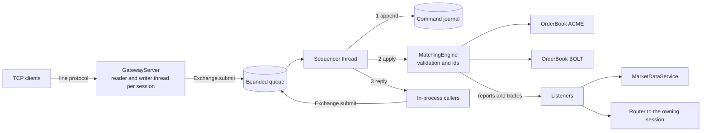

# Order Matching Engine

[](https://github.com/Worldisbinary/OrderMatchingEngine/actions/workflows/ci.yml)

A small exchange in Java 17, end to end: a TCP gateway, a single-threaded sequencer, a
write-ahead journal with crash recovery, and a limit order book that matches with strict
price-time priority. No dependencies outside the JDK.

- **Order types:** LIMIT, MARKET, IOC and FOK, plus cancel and amend (replace) with exchange priority rules.
- **Correctness:** checked against a deliberately naive reference book on 200,000 random commands, with structural invariants verified after every command.
- **Determinism:** the same commands always give byte-identical output, so replaying the journal rebuilds the exact state after a restart.
- **Speed (laptop):** 218 ns per command in the engine (JMH). End to end through the queue, sequencer and reply: 2.5 µs median at 973,000 commands/s; with every command journaled before it is acknowledged: 5.5 µs median at 231,000 commands/s.

## Quick start

Needs JDK 17 or newer. The Maven wrapper downloads Maven itself (on Windows use `mvnw.cmd`).

```bash
./mvnw verify                                            # build and run all 118 tests
java -jar target/order-matching-engine.jar demo          # guided tour, prints every report

java -jar target/order-matching-engine.jar server        # terminal 1: exchange on 127.0.0.1:9090
java -jar target/order-matching-engine.jar client        # terminals 2 and 3: trade against each other

java -jar target/order-matching-engine.jar loadtest 1000000 4 --journal
./mvnw test-compile exec:exec                            # JMH benchmarks
```

## Architecture



1. **Gateway** (`gateway`): parses the text protocol. Each connection has a reader thread and a writer thread with an outbox, so a slow client never stalls the engine. Execution reports are routed to the account that owns the order, including fills caused by other accounts.
2. **Exchange** (`engine.Exchange`): the thread-safe front door. Any number of threads call `submit`; commands wait in one bounded queue (full queue = back-pressure, nothing is dropped).
3. **Sequencer thread**: takes commands in order, writes each to the **journal first**, applies it, and acknowledges the caller once the journal is flushed. It is the only thread that touches the books, so matching needs no locks. It spins briefly before parking, because waking a parked thread costs far more than matching a command.
4. **MatchingEngine** (`engine.MatchingEngine`): validates (symbol, quantity, price, tick size, ownership), assigns order ids, trade ids and sequence numbers, and routes to the right book.
5. **OrderBook** (`book.OrderBook`): matching. Every change is published as a FIX-style `ExecutionReport` (`NEW`, `TRADE`, `REPLACED`, `CANCELLED`, `REJECTED`) and every match as a `Trade`.

## Matching rules

| Order type | Behaviour |
|---|---|
| `LIMIT` | Trades at the limit price or better; the remainder rests on the book. |
| `MARKET` | Trades at any price; the remainder is cancelled (`NO_LIQUIDITY`). Never rests. |
| `IOC` | Trades up to the limit price; the remainder is cancelled (`IOC_REMAINDER`). |
| `FOK` | Trades the full quantity up to the limit price, or nothing (`FOK_NOT_FILLABLE`). The book is untouched if it cannot fill. |

- **Price-time priority:** best price first; at the same price, the earliest order first.
- **Trade price:** always the resting (maker) order's price.
- **Amend (replace):** same price with an equal or lower quantity keeps the order's place in the queue. A price change or a quantity increase sends it to the back of the queue at the new price, where it may trade straight away if it crosses.
- **Ownership:** only the account that placed an order can cancel or amend it. Anyone else gets `REJECTED UNKNOWN_ORDER`, which does not reveal whether the order exists.
- **Prices** are fixed-point `long`s in 0.01 units (101.25 is stored as 10125), so book keys compare exactly. Each instrument has a tick size; `ACME` trades in 0.05 steps and `BOLT` in 0.01.
- **Rejects** (`UNKNOWN_SYMBOL`, `INVALID_QUANTITY`, `INVALID_PRICE`, `PRICE_NOT_ON_TICK`, `UNKNOWN_ORDER`) are reports too, so bad requests are journaled and replay identically.

## Data structures

| Structure | Used for | Cost |
|---|---|---|
| `TreeMap<Long, PriceLevel>` per side (bids descending, asks ascending) | price levels, best price first | add or remove a level O(log P) |
| Intrusive doubly linked list per `PriceLevel` | FIFO time priority; orders are the list nodes | append O(1), match from head O(1), **remove any order O(1)** |
| `HashMap<Long, Order>` | find a resting order by id for cancel and amend | O(1) |
| Running total per level | depth and fill-or-kill checks without walking the queue | O(1) |

v1 cancelled by scanning an `ArrayDeque` for the order id. v2 orders know their neighbours, so a cancel unlinks them directly. JMH, cancelling a random order out of one price level and re-queueing it:

| Orders queued at the level | v1 `ArrayDeque` scan | v2 intrusive list |
|---:|---:|---:|
| 10 | 41.5 ± 1.5 ns | 16.7 ± 0.4 ns |
| 100 | 96.7 ± 1.9 ns | 15.5 ± 0.5 ns |
| 1,000 | 602 ± 99 ns | 15.4 ± 0.5 ns |
| 10,000 | 7,526 ± 1,876 ns | 30.4 ± 1.1 ns |

## Determinism, journal and recovery

The engine is single-threaded and its only input is the command stream. Ids come from counters, and nothing depends on wall-clock time or hash order. So the same commands in the same order always produce the same reports, trades and books; a test hashes 20,000 commands' worth of output twice and compares the SHA-256.

That makes recovery simple. Every command is appended to the journal before it is applied (`N|alice|ACME|SELL|LIMIT|10010|100`), and on start-up the exchange replays the journal into a fresh engine. Other details:

- **Group commit:** the journal is flushed whenever the queue runs empty (or every 1,024 commands under sustained load), and only then are those commands acknowledged. A burst shares one write, and an acknowledged command is always in the journal. A test checks the file after every acknowledgement.
- **Torn writes:** a crash mid-write can leave a partial last line. It is ignored on read and trimmed before new commands are appended. A corrupt complete line is an error, not silently skipped.
- **Tested end to end:** 4 threads submit 12,000 commands concurrently, the exchange is closed and reopened from the journal, and every resting order, id counter and statistic must match exactly.

## TCP protocol

One request per line; each reply ends with `OK` or `ERR <message>`, and `OK` is only sent once the command is in the journal. `EXEC` lines are pushed to the account that owns the order. The gateway binds to 127.0.0.1 only, because there is no authentication.

```
LOGIN <account>
NEW <BUY|SELL> <SYMBOL> <LIMIT|IOC|FOK> <QTY> <PRICE>
NEW <BUY|SELL> <SYMBOL> MARKET <QTY>
CANCEL <SYMBOL> <ORDER_ID>
REPLACE <SYMBOL> <ORDER_ID> <QTY> <PRICE>
BOOK <SYMBOL> [DEPTH]
STATS <SYMBOL>
HELP | QUIT
```

A real session (bob buys from alice's resting order):

```
> LOGIN bob
OK
> NEW BUY ACME LIMIT 30 100.10
EXEC seq=3 exec=NEW order=3 account=bob symbol=ACME side=BUY type=LIMIT price=100.10 leaves=30 cum=0 status=OPEN
EXEC seq=4 exec=TRADE order=3 account=bob symbol=ACME side=BUY type=LIMIT price=100.10 leaves=0 cum=30 lastQty=30 lastPrice=100.10 trade=1 status=FILLED
OK
> BOOK ACME
BOOK ACME
ASK 100.20 50 1
ASK 100.10 70 1
OK
> STATS ACME
STATS symbol=ACME trades=1 volume=30 open=100.10 high=100.10 low=100.10 last=100.10 vwap=100.1000
OK
```

Alice, if connected, receives her own `EXEC ... exec=TRADE order=1 ... leaves=70 cum=30` at the same moment.

## Testing

`./mvnw verify` runs 118 tests:

- **Differential testing:** a seeded random flow (passive and aggressive limits, market, IOC, FOK, cancels and amends) runs against the real book and against `ReferenceBook`, a deliberately naive version that finds the best order by scanning a flat list. After every command, the trades and the full book (every order, in queue order) must be identical: 50 seeds x 4,000 commands = 200,000 commands.
- **Invariants after every command:** levels sorted and never empty, queue links intact, level totals equal the sum of their orders, the id index matches the queues, and the book is never crossed.
- **Unit tests** for every order type, priority rule, amend rule, reject reason, the journal (round trip, torn tail, corruption) and the codecs.
- **Concurrency:** 8 threads submit at once; every command must be applied exactly once with no gaps in sequence numbers.
- **Gateway:** real TCP clients, covering login, routing of fills to the counterparty, account isolation, every command and bad input.

CI runs the suite on Java 17 and 21, then runs the demo, a journaled load test and a short benchmark.

## Performance

Measured on an Intel Core i3-1125G4 laptop (4 cores, 8 threads) under WSL2, OpenJDK 21. Treat the numbers as relative; other machines will differ.

**Engine alone** (JMH, `MatchingBenchmark`): a recorded random flow of 200,000 commands (55% passive limits, 25% aggressive orders, 20% cancels and amends) applied to a fresh engine.

| Benchmark | Result |
|---|---|
| Average cost per command | **218 ± 15 ns** (99.9% CI, 3 forks x 10 iterations), about 4.6 million commands/s |

**Full pipeline** (`loadtest 1000000 4` with and without `--journal`): 4 producer threads submit through `Exchange` and wait for each reply, so every command pays for the queue hand-off, the sequencer and the reply, plus the journal write when it is on. 1,000,000 measured commands per row, after a warm-up.

| Producers wait by | Journal | Throughput | p50 | p90 | p99 | p99.9 |
|---|---|---:|---:|---:|---:|---:|
| spinning on the reply | off | 973,000 commands/s | 2.5 µs | 3.9 µs | 19 µs | 158 µs |
| spinning on the reply | on | 231,000 commands/s | 5.5 µs | 48 µs | 146 µs | 250 µs |
| blocking on the reply | off | 59,700 commands/s | 61 µs | 78 µs | 124 µs | 291 µs |
| blocking on the reply | on | 58,700 commands/s | 64 µs | 78 µs | 111 µs | 193 µs |

What the numbers say:

- **Thread wake-ups dominate.** Matching takes about 0.2 µs, but a blocked producer takes about 60 µs to be woken by the operating system (slower inside a WSL2 virtual machine). That is why low-latency systems spin instead of blocking, and why the sequencer here spins briefly before parking.
- **Durability has a price.** With the journal on, a command is acknowledged only after its batch is written. With 4 closed-loop clients the queue drains almost every command, so most commands pay for a write system call; more concurrent clients would share each write.
- **This laptop is noisy.** Repeated load-test runs vary by up to 2x. The JMH figure, with its confidence interval, is the reliable one.

## Project structure

```
src/main/java/com/ome/
  Main.java          demo | server | client | loadtest
  model/             Side, OrderType, OrderStatus, ExecType, Reason, Prices, Instrument, Trade, ExecutionReport
  command/           NewOrder, CancelOrder, ReplaceOrder and their journal codec
  book/              OrderBook, PriceLevel (intrusive queue), Order, snapshots
  engine/            MatchingEngine, Exchange (sequencer), CommandJournal
  marketdata/        trade statistics: open, high, low, last, volume, VWAP
  gateway/           GatewayServer, Session, Protocol, TerminalClient
  sim/               RandomOrderFlow, seeded order flow for tests and benchmarks
  cli/               Demo, LoadTest, ServerMain
src/test/java/com/ome/
  book/              OrderBookTest, ReplaceTest, DifferentialTest + ReferenceBook, CancelBenchmark
  engine/            MatchingEngineTest, ExchangeTest, CommandJournalTest
  gateway/           GatewayServerTest
  bench/             MatchingBenchmark (JMH)
```

## Limitations

- One process and one sequencer thread: no replication or failover, and throughput is bounded by a single core.
- The journal is flushed to the operating system before a command is acknowledged, but not fsynced: an acknowledged command survives the JVM crashing, but a power cut can lose the most recent ones.
- No authentication, no self-trade prevention, no order-status queries after a disconnect, and no market-data feed beyond `BOOK` and `STATS`.
- Reports for an account that is not connected are not stored; the journal still has the full history.
- `TreeMap` keys are boxed `Long`s; a production engine would use primitive collections or a price-indexed array to avoid allocation.

## Licence

MIT, see [LICENSE](LICENSE).
